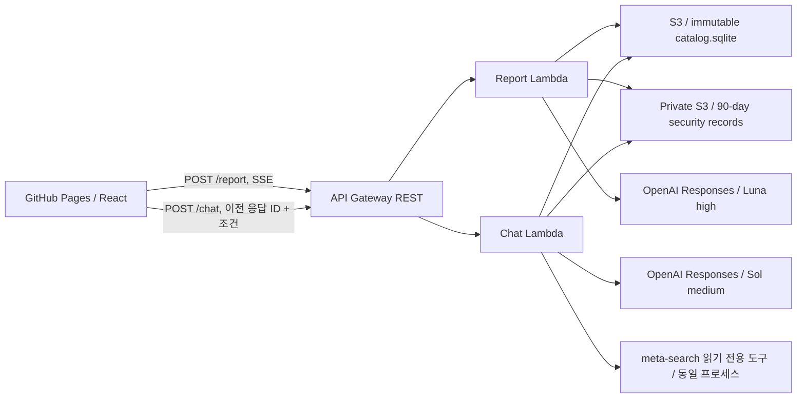

# Review Catalog Platform Demo

[웹 데모](https://subjective-experience-shopping-platform.github.io/review-catalog-platform-demo/#chat) · [GitHub](https://github.com/subjective-experience-shopping-platform/review-catalog-platform-demo)

`review-catalog-platform`과 `meta-search mcp`의 데모를 제공하는 레포지토리입니다. `review-catalog-platform`의 과도한 EC2 청구 비용을 방지하기 위해 KR-SBERT(텍스트 임베딩 모델)과 같은 무거운 의존성을 의도적으로 제거했습니다. AWS Lambda로 가볍게 데모를 시연하는 것이 목적입니다.

본 데모에서는 몇 가지 내용을 의도적으로 제거하거나 단순화했습니다.

- **데이터 확장 제한**: 이 데모는 [속성기반 감정분석 데이터셋](https://aihub.or.kr/aihubdata/data/view.do?dataSetSn=71603)에서 추출한 데이터 중 모니터 9개만 검색하고 활용하도록 범위를 제한합니다. 새로운 상품을 추가하는 기능과 인터넷 검색 기능은 저작권법 준수를 위하여 의도적으로 제외했습니다.
- **판매 속성은 더미데이터입니다**: 이 데모에서 사용된 속성기반 감정분석 데이터셋에는 상품의 배송 정보와 같은 판매 속성이 없습니다. 데모에서 사용된 판매 속성 정보는 그럴듯하게 만든 더미데이터입니다.
- **메인 아키텍쳐 변화**: 기존 AWS EC2에서 모놀로식으로 처리하던 내용을 gh-pages로 Frontend를 호스팅하며 Backend는 두 개의 AWS Lambda로, DB는 AWS S3에서 Sqlite 단일 파일로서 관리합니다.
- **텍스트 임베딩 및 군집화 제거**: `review-catalog-platform`의 군집화로 도출한 exact-match table만을 이용하여 정규화를 수행합니다. 이에 따라 기존 서비스 대비 28%의 체감 속성이 정규화에 실패하고 원 상태를 유지합니다.
- **DB 단순화**: 기존 시스템은 DuckDB를 이용해 리뷰를, PostgreSQL를 이용해 운영을 수행하였습니다. 하지만 본 데모에서는 SQLite3로 통합 관리합니다.

위 내용을 제외한 대부분의 기능은 `review-catalog-platform`과 `meta-search` 레포지토리 기능과 코드를 그대로 사용합니다.

## 프로젝트 문서 화면

메인 페이지는 GitHub `main` 브랜치의 README 원문을 다음 순서로 불러옵니다.

1. 조직 소개 (`.github/profile/README.md`)
2. 속성 추출 실험 (`semantic-review-extraction-experiment/README.md`)
3. 통합 검색 (`meta-search/README.md`)
4. 카탈로그 파이프라인 (`review-catalog-platform/README.md`)

문서 목록과 하단의 이전·다음 링크로 이동하며, `#home/experiment`, `#home/search`, `#home/platform`으로 개별 문서를 직접 열 수 있습니다. 문서 선택은 브라우저 뒤로가기와 새로고침에도 유지됩니다. 같은 데모의 `#chat`·`#report` 링크는 현재 탭에서 이동하므로 입력 중인 대화와 보고서를 페이지 메모리에 유지합니다. 외부 링크는 새 탭에서 열고 상대경로 문서 링크는 해당 GitHub 파일로 연결합니다.

HTML 이미지는 정제 후 렌더링합니다. README의 이미지 경로는 공개 raw URL로 작성해야 합니다. 로컬 README 수정은 해당 저장소에 반영한 뒤 화면에 표시됩니다. GitHub 연결 실패 시 다시 시도하거나 원문으로 이동할 수 있습니다.

프런트엔드 경로·링크 계약은 Node.js 22.18 이상에서 `npm test --prefix frontend`로 검증합니다.

## 프로젝트 경계



Lambda는 실행이 끝나면 응답을 종료합니다. 다음 요청이 같은 실행 환경에서 처리된다는 가정을 하지 않습니다. EC2, PostgreSQL, DuckDB, Airflow, 임베딩 모델, 재군집화 서버는 배포하지 않습니다. 기존 EC2 리소스의 종료·삭제는 이 프로젝트의 배포에 포함되지 않습니다.

## 실행 및 배포

### 로컬 실행

```bash
uv sync --frozen
cp .env.example .env  # 이미 .env가 있다면 이 코드를 실행하지 말아야 합니다. 덮어써집니다.
CATALOG_PATH="$PWD/data/catalog.sqlite" PYTHONPATH=backend \
  uv run --env-file .env uvicorn demo.app:app --host 127.0.0.1 --port 8000 --no-access-log
```

새로운 터미널에서 Frontend 서버를 열어 확인할 수 있습니다.

```bash
npm ci --prefix frontend
VITE_API_URL=http://127.0.0.1:8000 npm run dev --prefix frontend
```

`http://127.0.0.1:5173/review-catalog-platform-demo/`에서 확인합니다. 이때 몇 가지 주의사항이 있습니다.

- `.env`의 `SESSION_SIGNING_SECRET`은 충분히 긴 임의 값으로 설정합니다. AWS 배포 스크립트가 없으면 자동 생성합니다.
- 로컬 실행도 `.env`의 `AUDIT_BUCKET`과 해당 버킷 쓰기 권한이 있는 AWS 인증이 필요합니다. 저장소를 설정하지 않으면 `AUDIT_UNAVAILABLE`로 처리를 거부합니다.
- 저장소가 준비된 상태에서 자리표시자 키를 사용하면 두 생성 경로가 `API_KEY_REQUIRED`를 반환합니다.

### AWS 배포

```bash
aws login
uv run python scripts/package_lambda.py
uv run python scripts/deploy.py
uv run python scripts/smoke.py
```

`infra/template.py`에서 재현 가능한 CloudFormation을 생성합니다. 배포 결과는 무시된 `deployment.json`과 `frontend/.env.local`에 기록됩니다. 반드시 동일하게 설정해야 하는 것은 아니지만 본 프로젝트에서는 아래 설정을 사용했습니다.

- 스택: `review-catalog-platform-demo-storage`, `review-catalog-platform-demo`
- 리전: `ap-northeast-2`
- 함수: `review-catalog-platform-demo-report`, `review-catalog-platform-demo-chat`
- 각 512MB / 최대 300초 / provisioned concurrency 없음
- API Gateway: Regional REST, `STREAM`, 경로별 초당 1개 / burst 3 제한
- 카탈로그 S3: 퍼블릭 액세스 차단·암호화·버전 관리, Lambda는 해당 카탈로그 객체 읽기 권한 보유
- 보안 기록 S3: 별도 비공개 버킷, AES256 암호화, HTTPS 강제, 90일 수명 주기. Lambda는 종류별 prefix에 조건부 PutObject만 가능하며 읽기·삭제 권한 없음
- 애플리케이션 요청 본문/모델 출력과 API Gateway 실행 본문 로그 비활성화, 런타임 로그 보관 7일

## 라이선스

프로젝트 코드는 [GNU GPL 3.0](LICENSE)을 따릅니다. 외부 데이터셋과 모델의 이용 조건은 각 원본 제공처의 조건을 따릅니다.

## 홈페이지 출처와 AWS 연결

GitHub Pages는 새 조직에서 배포하며, Actions 저장소 변수 `VITE_API_URL`로 기존 AWS API를 연결합니다. Lambda의 `ALLOWED_ORIGINS`는 새 Pages 출처만 허용합니다. 허용되지 않은 `Origin`의 요청은 모델 호출과 보안 기록 저장 전에 HTTP 403 `ORIGIN_NOT_ALLOWED`로 거부합니다. Origin 헤더가 없는 운영 점검 요청은 허용하며, 이 출처 검사는 API 사용자 인증을 대신하지 않습니다.

배포 스크립트는 `.env`의 `PUBLIC_ORIGIN`을 사용하며 기본값은 `https://subjective-experience-shopping-platform.github.io`입니다. 저장소 이관으로 Lambda·API Gateway·S3를 새로 만들지 않습니다.
